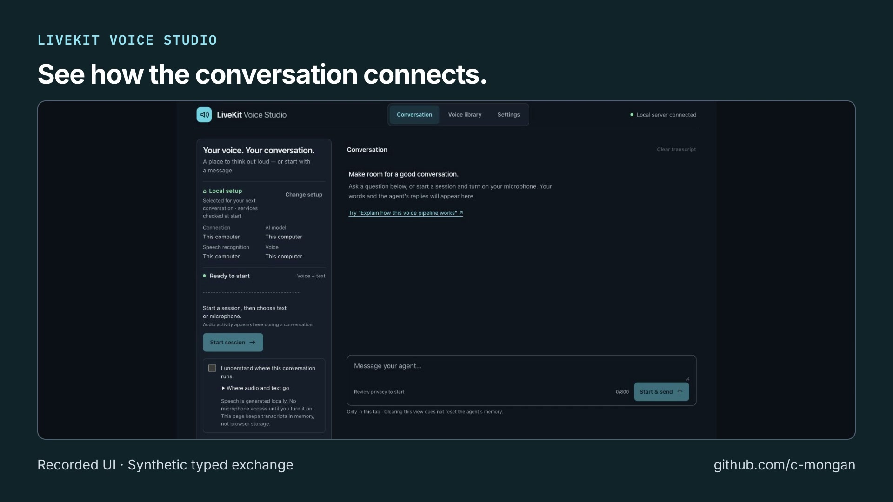

# LiveKit Voice Studio: short video overview

[Open or download the MP4](https://github.com/user-attachments/assets/dbd6a64e-f238-4d63-b099-c39adb7132f0) · [Transcript](transcript.txt) · [Captions (SRT)](captions.srt) · [Captions (VTT)](captions.vtt)

Recorded UI and a synthetic typed exchange. Apple Silicon development preview; this clip does not demonstrate microphone capture.

The video introduces the project; it does not replace its validation records or documented limits.

## Media details

- Duration: 22.033 seconds; 1920 × 1080; 30 fps; H.264 video and AAC audio.
- Published video SHA-256: `e733f84504a4cf174542cb7acf0c084ecb26f9b267f8913be4a0f746bb370f41`.
- AI narration: Inworld TTS 2, using the voice selected by the project author.
- Music: *Happy Beats / Business Moves Vol. 10* by [Sascha Ende, ende.app](https://ende.app/en), licensed under [CC BY 4.0](https://ende.app/en/standard-license). The track is trimmed, faded, and mixed beneath speech.
- Story and video workflow: [Brag](https://github.com/latent-spaces/brag); rendered locally with [Hyperframes](https://github.com/heygen-com/hyperframes).

## Visual sources

- [README.md](https://github.com/c-mongan/livekit-voice-studio/blob/f2c872cc1ef26e89f5b26eb3c507c1fc24d8f975/README.md) — source Git blob `f1a1f85ebc542b355ba98803ef59a9341b7212f9`.
- [studio-local.jpg](https://github.com/c-mongan/livekit-voice-studio/blob/f2c872cc1ef26e89f5b26eb3c507c1fc24d8f975/docs/studio-local.jpg) — source Git blob `d6a3f0096d105b1aa7947aac99fbf33a721eeda1`.
- [studio-reply.jpg](https://github.com/c-mongan/livekit-voice-studio/blob/f2c872cc1ef26e89f5b26eb3c507c1fc24d8f975/docs/studio-reply.jpg) — source Git blob `dcb187737188212735e632de870ea0b420884090`.
